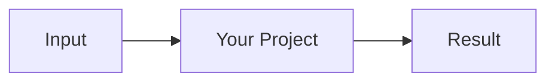

<div align="center">


<a href="https://git.io/typing-svg">
  
</a>

<br>


<br>

**[Live Demo](https://example.com)** · **[Docs](docs/)** · **[Report Bug](../../issues)** · **[Request Feature](../../issues)**

<br>


</div>

---

## 🎯 The Problem

One short paragraph. What sucks today, and who feels it?

## 💥 The Solution

One short paragraph. What does your project do differently?

| Before | After |
|--------|-------|
| ❌ Slow, manual process | ✅ Automated in one command |
| ❌ Scattered tools | ✅ One place for everything |
| ❌ Hard to set up | ✅ Ready in 60 seconds |

## ✨ Features

- 🚀 **Feature one**: short, concrete benefit
- 🔐 **Feature two**: short, concrete benefit
- 🧩 **Feature three**: short, concrete benefit
- 📦 **Feature four**: short, concrete benefit

## ⚡ Quick Start

```bash
git clone https://github.com/username/projectname.git
cd projectname
# your install/run commands here
```

> 💡 **Tip:** keep this section to 3–5 commands. If setup is longer, link to the docs.

## 🖼 Screenshots

<div align="center">
  
  
</div>

## 🧱 How It Works



## 🗺 Roadmap

- [x] Core functionality
- [ ] Next big feature
- [ ] Nice-to-have

## 🤝 Contributing

PRs are welcome. Fork, branch, commit, open a pull request. Good first issues are labeled [`good first issue`](../../labels/good%20first%20issue).

## 📄 License

MIT © [username](https://github.com/username)

<div align="center">

⭐ **If this helped you, drop a star. It really helps!** ⭐


</div>
